# COD-CHART 차트별 Contents 명세

첨부된 COD-PRO 문서의 Chart Contents 구성에 맞춘 COD-CHART 구현 기준입니다. 각 항목은 이름, 원본 코드, 화면, 데이터 예제 및 설명을 제공합니다.

- 원본 Contents Code는 참고용이며 라이브러리는 숫자 코드가 아닌 `type`을 사용합니다.
- 화면은 데모의 실제 캡처이며, 아래 데이터 예제는 읽기 쉽게 축약하여 화면의 모든 데이터와 일치하지 않을 수 있습니다.
- 예제는 `CvChart`의 `definition`에 전달하는 완전한 JSON 객체입니다. `contentsData`는 `data`, `encoding`, `dataSource`와 함께 사용할 수 없습니다.
- 행 기반 차트에도 공통 `data.fields`/`data.rows` 형식을 사용합니다. 원본에 없는 유형의 Contents Data 지원을 의미하지 않습니다.
- 설치와 컴포넌트 사용법은 [사용 매뉴얼](../component-manual.md)을 참고하세요.

## 선형 차트

**Contents name:** 선형 차트<br>
**Contents Code:** 4<br>
**COD-CHART type:** `line`<br>
**Contents View:**

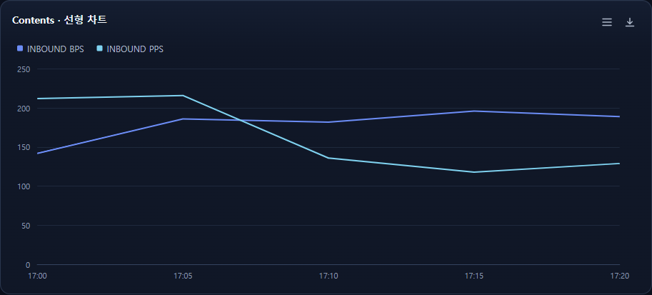

**Contents Data:** 아래 정의의 contentsData

```json
{
  "schemaVersion": "1.0.0",
  "id": "example-line",
  "type": "line",
  "renderer": "svg",
  "contentsData": {
    "timesArr": ["17:00","17:05","17:10"],
    "data": [
      {
        "key": "INBOUND BPS",
        "color": "#4D8DFF",
        "values": [{"x":0,"y":142},{"x":1,"y":186},{"x":2,"y":182}]
      },
      {
        "key": "INBOUND PPS",
        "color": "#36D6F5",
        "values": [{"x":0,"y":212},{"x":1,"y":216},{"x":2,"y":136}]
      }
    ]
  }
}
```

**Data Description:** 시계열 또는 범주에 따른 값의 변화를 선으로 표시합니다. timesArr는 축 라벨 배열입니다. data의 key는 시리즈명, values의 x는 0부터 시작하는 timesArr 인덱스, y는 수치입니다. color는 선택 사항입니다.

## 영역 차트

**Contents name:** 영역 차트<br>
**Contents Code:** 5<br>
**COD-CHART type:** `area`<br>
**Contents View:**

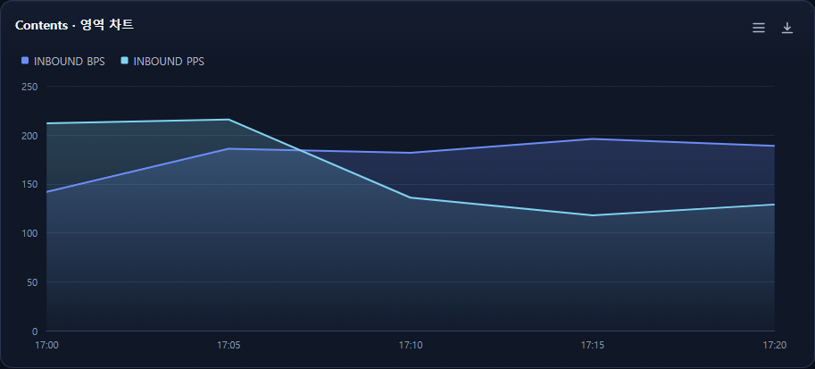

**Contents Data:** 아래 정의의 contentsData

```json
{
  "schemaVersion": "1.0.0",
  "id": "example-area",
  "type": "area",
  "renderer": "svg",
  "contentsData": {
    "timesArr": ["17:00","17:05","17:10"],
    "data": [
      {
        "key": "INBOUND BPS",
        "color": "#4D8DFF",
        "values": [{"x":0,"y":142},{"x":1,"y":186},{"x":2,"y":182}]
      },
      {
        "key": "INBOUND PPS",
        "color": "#36D6F5",
        "values": [{"x":0,"y":212},{"x":1,"y":216},{"x":2,"y":136}]
      }
    ]
  }
}
```

**Data Description:** 선 아래 영역을 채워 값의 추세와 크기를 표시합니다. line과 같은 contentsData를 사용합니다. timesArr의 유효 인덱스와 숫자 y가 필요합니다.

## 수평 막대 차트

**Contents name:** 수평 막대 차트<br>
**Contents Code:** 6<br>
**COD-CHART type:** `bar`<br>
**Contents View:**

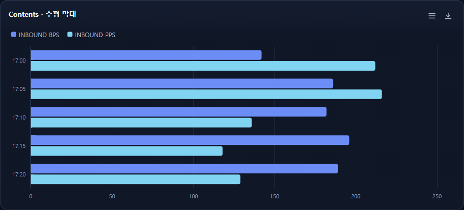

**Contents Data:** 아래 정의의 contentsData

```json
{
  "schemaVersion": "1.0.0",
  "id": "example-bar",
  "type": "bar",
  "renderer": "svg",
  "contentsData": {
    "timesArr": ["17:00","17:05","17:10"],
    "data": [
      {
        "key": "INBOUND BPS",
        "color": "#4D8DFF",
        "values": [{"x":0,"y":142},{"x":1,"y":186},{"x":2,"y":182}]
      },
      {
        "key": "INBOUND PPS",
        "color": "#36D6F5",
        "values": [{"x":0,"y":212},{"x":1,"y":216},{"x":2,"y":136}]
      }
    ]
  }
}
```

**Data Description:** 범주별 값을 가로 막대로 비교합니다. line과 같은 contentsData를 사용합니다. 시리즈별 values의 x는 timesArr 인덱스입니다.

## 수직 막대 차트

**Contents name:** 수직 막대 차트<br>
**Contents Code:** 8<br>
**COD-CHART type:** `column`<br>
**Contents View:**

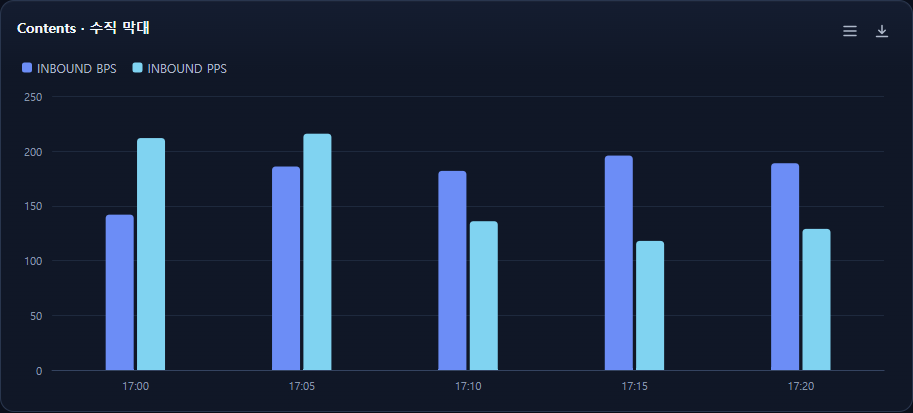

**Contents Data:** 아래 정의의 contentsData

```json
{
  "schemaVersion": "1.0.0",
  "id": "example-column",
  "type": "column",
  "renderer": "svg",
  "contentsData": {
    "timesArr": ["17:00","17:05","17:10"],
    "data": [
      {
        "key": "INBOUND BPS",
        "color": "#4D8DFF",
        "values": [{"x":0,"y":142},{"x":1,"y":186},{"x":2,"y":182}]
      },
      {
        "key": "INBOUND PPS",
        "color": "#36D6F5",
        "values": [{"x":0,"y":212},{"x":1,"y":216},{"x":2,"y":136}]
      }
    ]
  }
}
```

**Data Description:** 범주별 값을 세로 막대로 비교합니다. line과 같은 contentsData를 사용합니다. 시리즈별 values의 x는 timesArr 인덱스입니다.

## 선형 차트(Point)

**Contents name:** 선형 차트(Point)<br>
**Contents Code:** 21<br>
**COD-CHART type:** `line`<br>
**Contents View:**

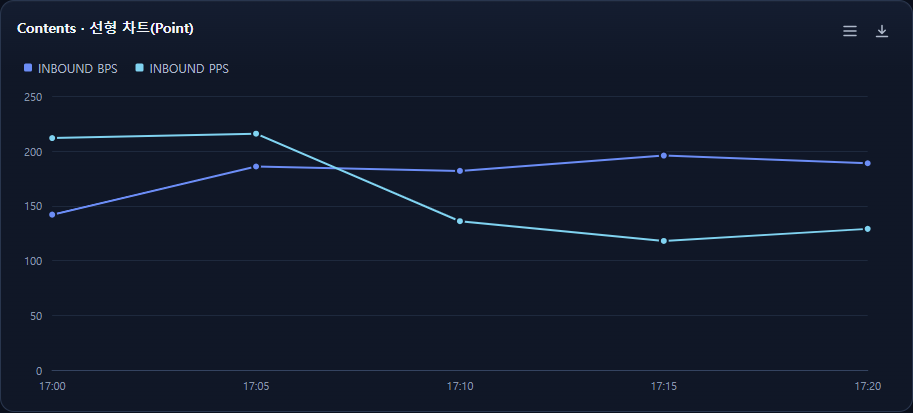

**Contents Data:** 아래 정의의 contentsData

```json
{
  "schemaVersion": "1.0.0",
  "id": "example-point",
  "type": "line",
  "renderer": "svg",
  "options": {"showPoints":true},
  "contentsData": {
    "timesArr": ["17:00","17:05","17:10"],
    "data": [
      {
        "key": "INBOUND BPS",
        "color": "#4D8DFF",
        "values": [{"x":0,"y":142},{"x":1,"y":186},{"x":2,"y":182}]
      },
      {
        "key": "INBOUND PPS",
        "color": "#36D6F5",
        "values": [{"x":0,"y":212},{"x":1,"y":216},{"x":2,"y":136}]
      }
    ]
  }
}
```

**Data Description:** 선형 차트의 데이터 지점을 표시합니다. line과 같은 contentsData를 사용하며 options.showPoints를 true로 설정합니다.

## Pie 차트

**Contents name:** Pie 차트<br>
**Contents Code:** 7<br>
**COD-CHART type:** `pie`<br>
**Contents View:**

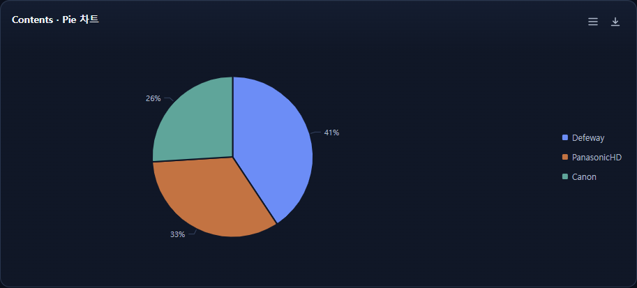

**Contents Data:** 아래 정의의 contentsData

```json
{
  "schemaVersion": "1.0.0",
  "id": "example-pie",
  "type": "pie",
  "renderer": "svg",
  "contentsData": [
    {"col0":"Canon","col1":11.3},
    {"col0":"PanasonicHD","col1":14.5},
    {"col0":"Defeway","col1":17.7}
  ]
}
```

**Data Description:** 항목별 구성 비율을 표시합니다. col0은 항목명, col1은 수치입니다. 도넛도 같은 Contents Data 형식을 지원합니다.

## Pie 차트(Polar)

**Contents name:** Pie 차트(Polar)<br>
**Contents Code:** 14<br>
**COD-CHART type:** `polar-pie`<br>
**Contents View:**

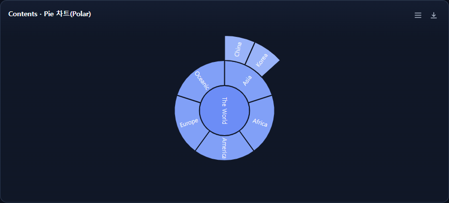

**Contents Data:** 아래 정의의 contentsData

```json
{
  "schemaVersion": "1.0.0",
  "id": "example-polar-pie",
  "type": "polar-pie",
  "renderer": "svg",
  "contentsData": [
    {"id":"0","parent":"","name":"The World","value":"15"},
    {"id":"1","parent":"0","name":"Asia","value":"3"},
    {"id":"1_1","parent":"1","name":"China","value":"1"},
    {"id":"1_2","parent":"1","name":"Korea","value":"1"}
  ]
}
```

**Data Description:** 부모 ID를 이용해 계층을 동심원으로 표시합니다. id는 고유 ID, parent는 부모 ID(루트는 빈 문자열), name은 표시명, value는 0 이상 수치입니다. 부모 누락과 순환은 허용되지 않습니다.

## Spider 차트

**Contents name:** Spider 차트<br>
**Contents Code:** 16<br>
**COD-CHART type:** `radar`<br>
**Contents View:**

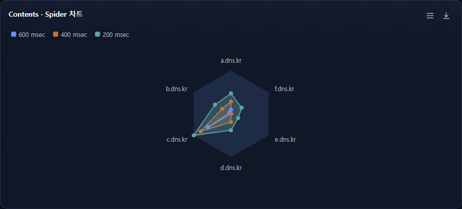

**Contents Data:** 아래 정의의 contentsData

```json
{
  "schemaVersion": "1.0.0",
  "id": "example-radar",
  "type": "radar",
  "renderer": "svg",
  "contentsData": {
    "categories": ["a.dns.kr","b.dns.kr","c.dns.kr"],
    "data": [
      {"name":"600 msec","data":[10,5,65],"pointPlacement":"on"},
      {"name":"400 msec","data":[30,25,85],"pointPlacement":"on"}
    ]
  }
}
```

**Data Description:** 범주별 수치를 레이더 형태로 비교합니다. categories와 각 시리즈 data의 길이는 같아야 합니다. name은 시리즈명이며 pointPlacement는 선택 필드입니다.

## Gauge 차트(다중)

**Contents name:** Gauge 차트(다중)<br>
**Contents Code:** 22<br>
**COD-CHART type:** `gauge`<br>
**Contents View:**

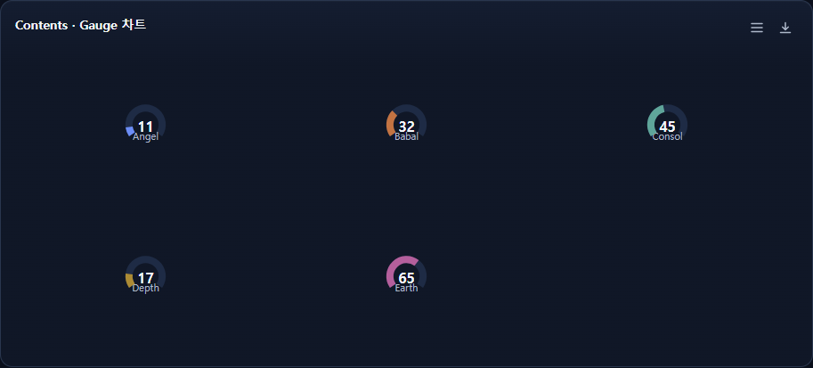

**Contents Data:** 아래 정의의 contentsData

```json
{
  "schemaVersion": "1.0.0",
  "id": "example-gauge-group",
  "type": "gauge",
  "renderer": "svg",
  "contentsData": [
    {"col0":"Angel","col1":11},
    {"col0":"Babal","col1":32},
    {"col0":"Consol","col1":45}
  ]
}
```

**Data Description:** 각 항목을 개별 게이지로 표시합니다. col0은 항목명, col1은 수치입니다. contentsData를 사용하는 gauge는 모든 항목을 표시하며 기본 범위는 0~100입니다.

## Bubble 차트

**Contents name:** Bubble 차트<br>
**Contents Code:** 31<br>
**COD-CHART type:** `bubble`<br>
**Contents View:**

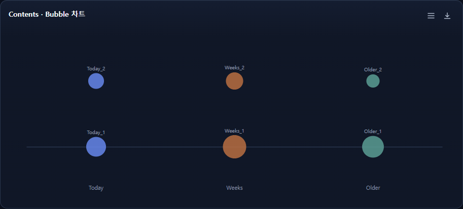

**Contents Data:** 아래 정의의 contentsData

```json
{
  "schemaVersion": "1.0.0",
  "id": "example-bubble",
  "type": "bubble",
  "renderer": "svg",
  "contentsData": [
    {
      "categories": ["Today","Weeks"],
      "data": [
        {"name":["Today_1","Today_2"],"value":[51,24]},
        {"name":["Weeks_1","Weeks_2"],"value":[84,33]}
      ]
    }
  ]
}
```

**Data Description:** 범주와 항목별 값을 원의 크기로 표시합니다. 배열에 객체 1개가 필요합니다. categories와 data 개수, 각 그룹의 name과 value 개수가 각각 같아야 합니다.

## Word Cloud

**Contents name:** Word Cloud<br>
**Contents Code:** 32<br>
**COD-CHART type:** `word-cloud`<br>
**Contents View:**

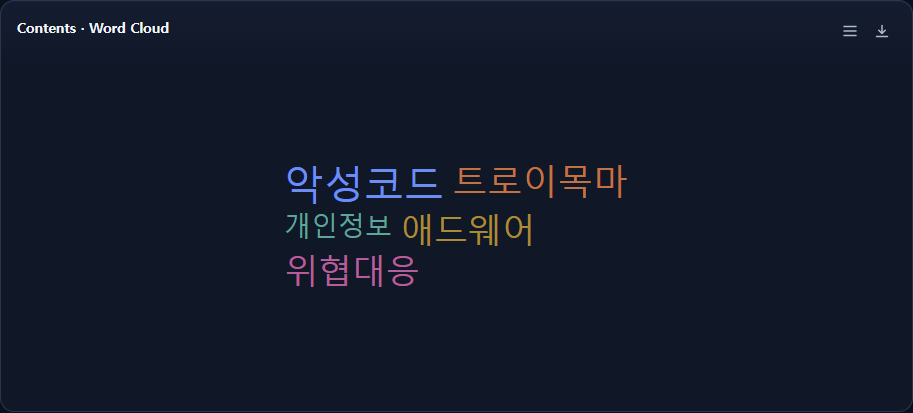

**Contents Data:** 아래 정의의 contentsData

```json
{
  "schemaVersion": "1.0.0",
  "id": "example-word-cloud",
  "type": "word-cloud",
  "renderer": "svg",
  "contentsData": [
    {"name":"악성코드","weight":12},
    {"name":"트로이목마","weight":8},
    {"name":"개인정보","weight":3}
  ]
}
```

**Data Description:** 가중치에 따라 단어의 크기를 표시합니다. name은 단어, weight는 가중치입니다. 수치는 숫자 또는 숫자 문자열을 사용할 수 있습니다.

## 누적 막대

**Contents name:** 누적 막대<br>
**Contents Code:** 해당 없음 (COD-CHART 추가 차트)<br>
**COD-CHART type:** `stacked-bar`<br>
**Contents View:**

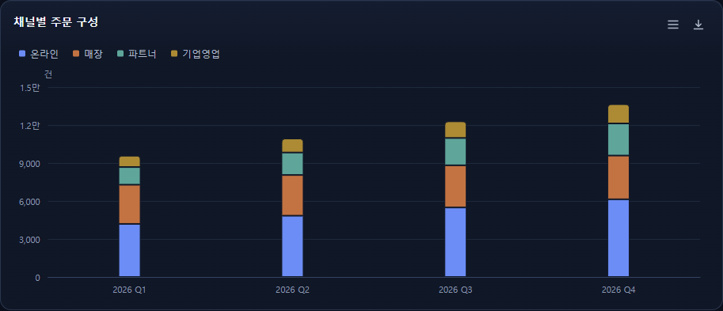

**Contents Data:** 아래 정의의 data 및 encoding (행 기반)

```json
{
  "schemaVersion": "1.0.0",
  "id": "example-stacked-bar",
  "type": "stacked-bar",
  "renderer": "svg",
  "data": {
    "fields": [
      {"name":"quarter","type":"string"},
      {"name":"channel","type":"string"},
      {"name":"orders","type":"number"}
    ],
    "rows": [
      {"quarter":"2026 Q1","channel":"온라인","orders":4200},
      {"quarter":"2026 Q1","channel":"매장","orders":3100},
      {"quarter":"2026 Q1","channel":"파트너","orders":1400}
    ]
  },
  "encoding": {"x":"quarter","y":"orders","color":"channel"},
  "options": {"stack":"stacked"}
}
```

**Data Description:** 범주별 시리즈 구성을 누적하여 표시합니다. x는 범주, y는 숫자, color는 시리즈 필드입니다. options.stack은 누적 방식을 지정합니다.

## 도넛

**Contents name:** 도넛<br>
**Contents Code:** 해당 없음 (COD-CHART 추가 차트)<br>
**COD-CHART type:** `donut`<br>
**Contents View:**

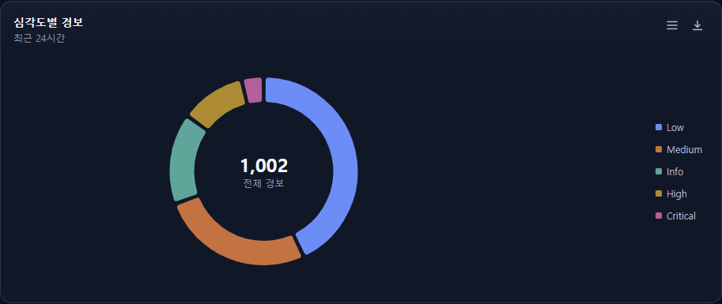

**Contents Data:** 아래 정의의 data 및 encoding (행 기반)

```json
{
  "schemaVersion": "1.0.0",
  "id": "example-donut",
  "type": "donut",
  "renderer": "svg",
  "data": {
    "fields": [{"name":"severity","type":"string"},{"name":"count","type":"number"}],
    "rows": [
      {"severity":"Critical","count":38},
      {"severity":"High","count":112},
      {"severity":"Medium","count":264}
    ]
  },
  "encoding": {"category":"severity","value":"count"}
}
```

**Data Description:** 항목 비율을 도넛 형태로 표시합니다. category는 항목명, value는 숫자 필드입니다. contentsData에서는 pie와 같은 col0/col1 배열도 사용할 수 있습니다.

## 단일 게이지

**Contents name:** 단일 게이지<br>
**Contents Code:** 해당 없음 (COD-CHART 추가 차트)<br>
**COD-CHART type:** `gauge`<br>
**Contents View:**

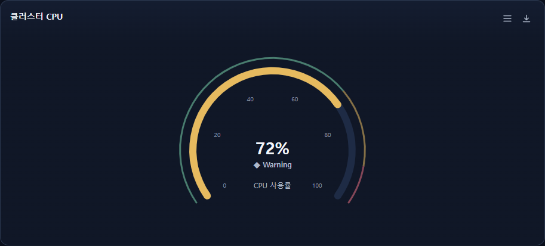

**Contents Data:** 아래 정의의 data 및 encoding (행 기반)

```json
{
  "schemaVersion": "1.0.0",
  "id": "example-gauge",
  "type": "gauge",
  "renderer": "svg",
  "data": {"fields":[{"name":"cpu","type":"number"}],"rows":[{"cpu":72}]},
  "encoding": {"value":"cpu"},
  "options": {"min":0,"max":100}
}
```

**Data Description:** 단일 값을 지정된 범위에 표시합니다. value는 숫자 필드입니다. options.min과 options.max로 범위를 지정합니다.

## 산점도

**Contents name:** 산점도<br>
**Contents Code:** 해당 없음 (COD-CHART 추가 차트)<br>
**COD-CHART type:** `scatter`<br>
**Contents View:**

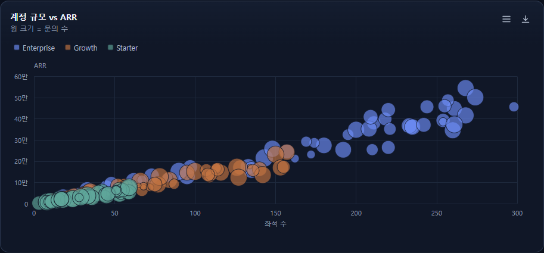

**Contents Data:** 아래 정의의 data 및 encoding (행 기반)

```json
{
  "schemaVersion": "1.0.0",
  "id": "example-scatter",
  "type": "scatter",
  "renderer": "svg",
  "data": {
    "fields": [
      {"name":"account","type":"string"},
      {"name":"tier","type":"string"},
      {"name":"seats","type":"number"},
      {"name":"arr","type":"number"},
      {"name":"tickets","type":"number"}
    ],
    "rows": [
      {
        "account": "ACC-1000",
        "tier": "Enterprise",
        "seats": 220,
        "arr": 265140,
        "tickets": 20
      },
      {"account":"ACC-1001","tier":"Growth","seats":19,"arr":27793,"tickets":21},
      {"account":"ACC-1002","tier":"Starter","seats":31,"arr":25757,"tickets":13}
    ]
  },
  "encoding": {"x":"seats","y":"arr","color":"tier","size":"tickets","label":"account"}
}
```

**Data Description:** 두 수치 간의 관계를 점으로 표시합니다. x와 y는 숫자 필드입니다. color, size, label은 선택 필드입니다.

## 히트맵

**Contents name:** 히트맵<br>
**Contents Code:** 해당 없음 (COD-CHART 추가 차트)<br>
**COD-CHART type:** `heatmap`<br>
**Contents View:**

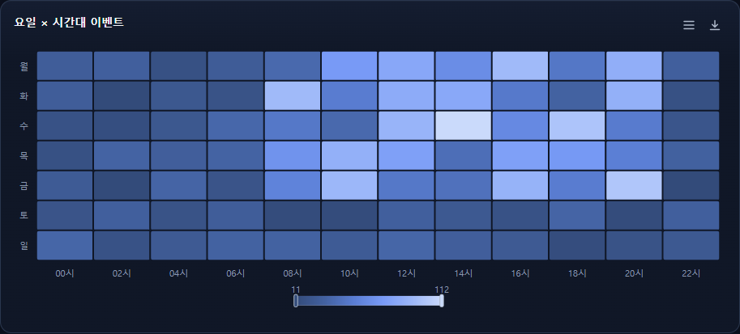

**Contents Data:** 아래 정의의 data 및 encoding (행 기반)

```json
{
  "schemaVersion": "1.0.0",
  "id": "example-heatmap",
  "type": "heatmap",
  "renderer": "svg",
  "data": {
    "fields": [
      {"name":"hour","type":"string"},
      {"name":"day","type":"string"},
      {"name":"events","type":"number"}
    ],
    "rows": [
      {"day":"월","hour":"00시","events":27},
      {"day":"월","hour":"02시","events":29},
      {"day":"월","hour":"04시","events":16}
    ]
  },
  "encoding": {"x":"hour","y":"day","value":"events"}
}
```

**Data Description:** 두 범주에 따른 수치 강도를 색상으로 표시합니다. x와 y는 축 필드, value는 숫자 필드입니다.

## 트리맵

**Contents name:** 트리맵<br>
**Contents Code:** 해당 없음 (COD-CHART 추가 차트)<br>
**COD-CHART type:** `treemap`<br>
**Contents View:**

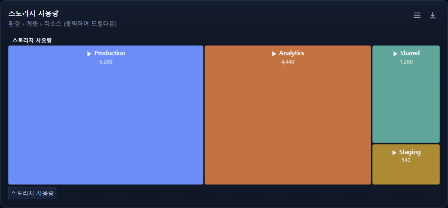

**Contents Data:** 아래 정의의 data 및 encoding (행 기반)

```json
{
  "schemaVersion": "1.0.0",
  "id": "example-treemap",
  "type": "treemap",
  "renderer": "svg",
  "data": {
    "fields": [
      {"name":"env","type":"string"},
      {"name":"tier","type":"string"},
      {"name":"name","type":"string"},
      {"name":"gb","type":"number"}
    ],
    "rows": [
      {"env":"Production","tier":"Database","name":"orders","gb":920},
      {"env":"Production","tier":"Database","name":"users","gb":410},
      {"env":"Production","tier":"Database","name":"events","gb":1280}
    ]
  },
  "encoding": {"path":["env","tier","name"],"value":"gb"}
}
```

**Data Description:** 계층 경로에 따른 비중을 사각형으로 표시합니다. path는 계층 순서의 필드 배열, value는 숫자 필드입니다.

## 캔들스틱

**Contents name:** 캔들스틱<br>
**Contents Code:** 해당 없음 (COD-CHART 추가 차트)<br>
**COD-CHART type:** `candlestick`<br>
**Contents View:**

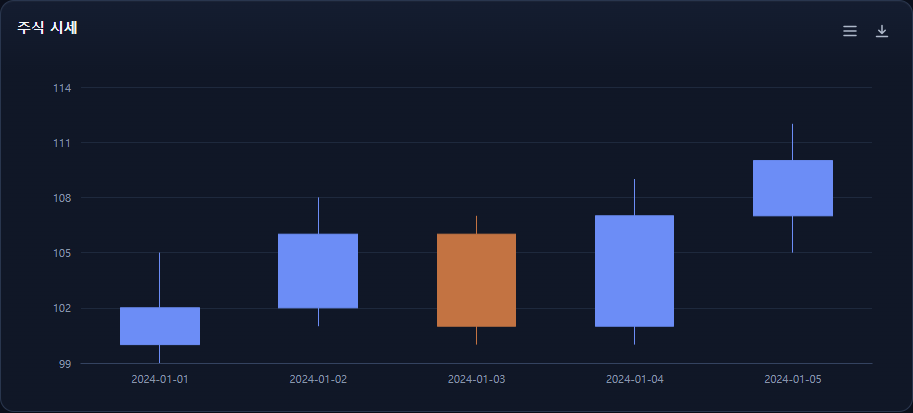

**Contents Data:** 아래 정의의 data 및 encoding (행 기반)

```json
{
  "schemaVersion": "1.0.0",
  "id": "example-candlestick",
  "type": "candlestick",
  "renderer": "svg",
  "data": {
    "fields": [
      {"name":"date","type":"string"},
      {"name":"open","type":"number"},
      {"name":"high","type":"number"},
      {"name":"low","type":"number"},
      {"name":"close","type":"number"}
    ],
    "rows": [
      {"date":"2024-01-01","open":100,"high":105,"low":99,"close":102},
      {"date":"2024-01-02","open":102,"high":108,"low":101,"close":106},
      {"date":"2024-01-03","open":106,"high":107,"low":100,"close":101}
    ]
  },
  "encoding": {"x":"date","y":["open","close","low","high"]}
}
```

**Data Description:** 시가·종가·저가·고가를 표시합니다. x는 날짜 또는 범주 필드이며 y는 [시가, 종가, 저가, 고가] 순서의 숫자 필드 배열입니다.

## 박스플롯

**Contents name:** 박스플롯<br>
**Contents Code:** 해당 없음 (COD-CHART 추가 차트)<br>
**COD-CHART type:** `boxplot`<br>
**Contents View:**

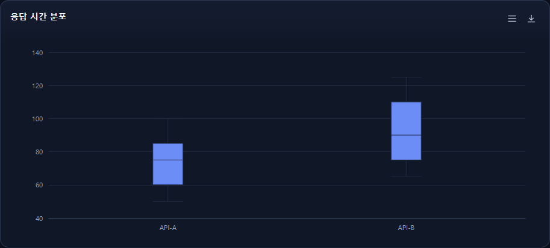

**Contents Data:** 아래 정의의 data 및 encoding (행 기반)

```json
{
  "schemaVersion": "1.0.0",
  "id": "example-boxplot",
  "type": "boxplot",
  "renderer": "svg",
  "data": {
    "fields": [{"name":"category","type":"string"},{"name":"value","type":"number"}],
    "rows": [
      {"category":"API-A","value":50},
      {"category":"API-A","value":60},
      {"category":"API-A","value":75}
    ]
  },
  "encoding": {"category":"category","value":"value"}
}
```

**Data Description:** 범주별 수치 분포를 요약합니다. category는 범주, value는 숫자 필드입니다. 범주별 값으로 사분위와 중앙값을 계산합니다.

## 깔때기

**Contents name:** 깔때기<br>
**Contents Code:** 해당 없음 (COD-CHART 추가 차트)<br>
**COD-CHART type:** `funnel`<br>
**Contents View:**

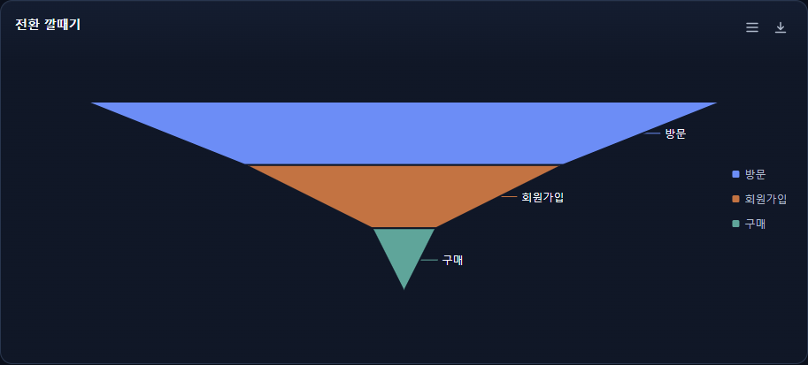

**Contents Data:** 아래 정의의 data 및 encoding (행 기반)

```json
{
  "schemaVersion": "1.0.0",
  "id": "example-funnel",
  "type": "funnel",
  "renderer": "svg",
  "data": {
    "fields": [{"name":"stage","type":"string"},{"name":"count","type":"number"}],
    "rows": [
      {"stage":"방문","count":10000},
      {"stage":"회원가입","count":5000},
      {"stage":"구매","count":1000}
    ]
  },
  "encoding": {"category":"stage","value":"count"}
}
```

**Data Description:** 단계별 수치의 감소를 표시합니다. category는 단계명, value는 숫자 필드입니다.

## 샌키

**Contents name:** 샌키<br>
**Contents Code:** 해당 없음 (COD-CHART 추가 차트)<br>
**COD-CHART type:** `sankey`<br>
**Contents View:**

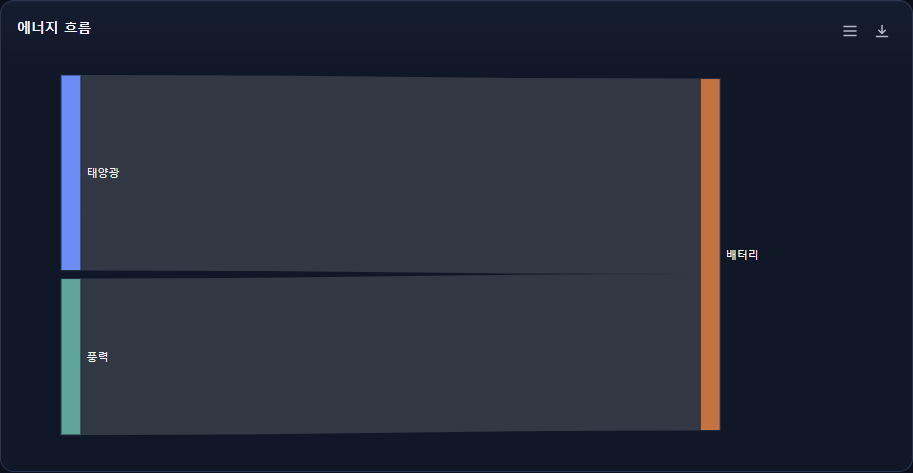

**Contents Data:** 아래 정의의 data 및 encoding (행 기반)

```json
{
  "schemaVersion": "1.0.0",
  "id": "example-sankey",
  "type": "sankey",
  "renderer": "svg",
  "data": {
    "fields": [
      {"name":"source","type":"string"},
      {"name":"target","type":"string"},
      {"name":"value","type":"number"}
    ],
    "rows": [
      {"source":"태양광","target":"배터리","value":100},
      {"source":"풍력","target":"배터리","value":80}
    ]
  },
  "encoding": {"path":["source","target"],"value":"value"}
}
```

**Data Description:** 출발지와 도착지 사이의 흐름을 표시합니다. path는 [출발지 필드, 도착지 필드], value는 흐름의 숫자 필드입니다.

## 선버스트

**Contents name:** 선버스트<br>
**Contents Code:** 해당 없음 (COD-CHART 추가 차트)<br>
**COD-CHART type:** `sunburst`<br>
**Contents View:**

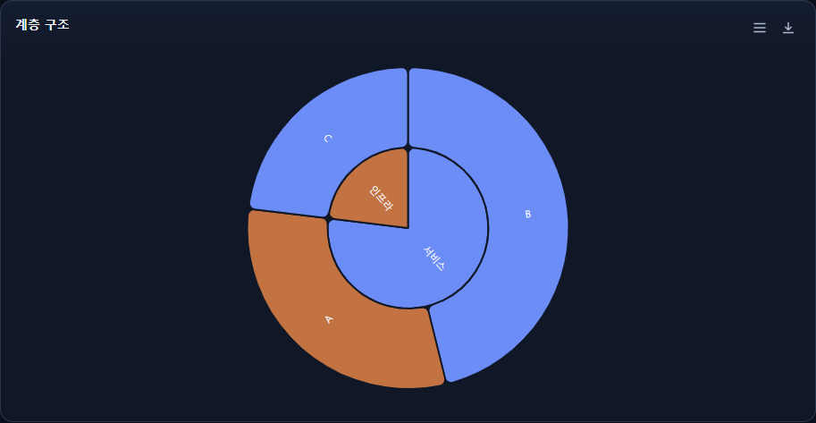

**Contents Data:** 아래 정의의 data 및 encoding (행 기반)

```json
{
  "schemaVersion": "1.0.0",
  "id": "example-sunburst",
  "type": "sunburst",
  "renderer": "svg",
  "data": {
    "fields": [
      {"name":"group","type":"string"},
      {"name":"name","type":"string"},
      {"name":"value","type":"number"}
    ],
    "rows": [
      {"group":"서비스","name":"A","value":40},
      {"group":"서비스","name":"B","value":60},
      {"group":"인프라","name":"C","value":30}
    ]
  },
  "encoding": {"path":["group","name"],"value":"value"}
}
```

**Data Description:** 계층 경로와 비중을 동심원으로 표시합니다. path는 계층 순서의 필드 배열, value는 숫자 필드입니다.
